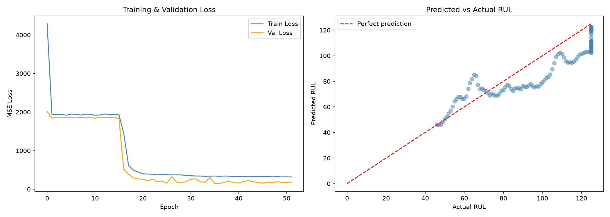
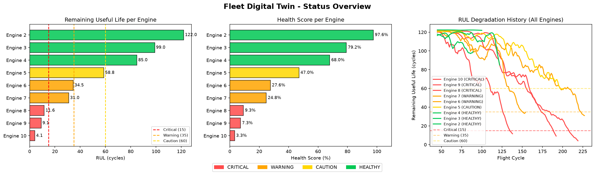
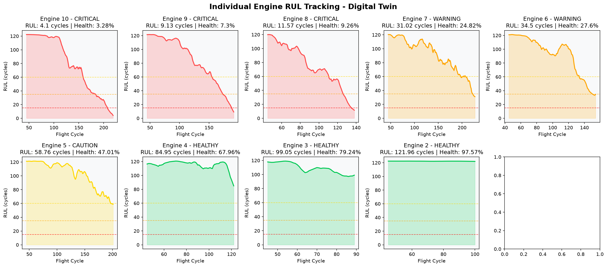

# Edge AI Digital Twin for Aerospace MRO
### Tata Technologies InnoVent Hackathon Submission

A production-ready predictive maintenance platform that runs an LSTM-based Remaining Useful Life (RUL) prediction model entirely on local CPU hardware, with no cloud dependency for inference. The system maintains a real-time digital twin for each engine in a fleet and surfaces actionable maintenance alerts through an interactive dashboard.

---

## The Problem

Unplanned engine failures in commercial aviation result in Aircraft on Ground (AOG) events that cost airlines between ₹50 lakh and ₹80 lakh per incident. Current MRO workflows rely on fixed maintenance schedules that are either too conservative (wasting serviceable life) or too reactive (missing early degradation signals). Data-driven predictive maintenance exists as a concept but typically requires cloud infrastructure, continuous internet connectivity, and expensive ML platforms that are impractical in hangar environments.

---

## The Solution

This system embeds a trained LSTM model directly into a fleet management dashboard that runs on any standard CPU workstation. An MRO engineer can monitor ten engines simultaneously, see each engine's predicted remaining life in real time, and receive tiered alerts before a failure occurs — all without sending a single byte of sensor data outside the facility.

---

## What Edge AI Means Here

Edge AI means the neural network inference runs on the local machine, not on a remote server. There is no AWS SageMaker, no Azure ML, no Google Vertex AI involved. The trained model is a 5 MB PyTorch file that loads onto any CPU. Inference takes approximately 2 milliseconds per prediction cycle. The dashboard works fully offline once deployed, making it suitable for hangars with restricted or no internet access.

---

## Architecture

```
NASA CMAPSS Sensor Data
        ↓
Sliding Window (45 cycles)
        ↓
MinMax Scaler (fitted on training set)
        ↓
LSTM Model  [3 layers, hidden size 100, dropout 0.3]
        ↓
RUL Prediction (cycles remaining)
        ↓
Digital Twin State Update  →  Alert Generation
        ↓
Streamlit Fleet Dashboard
```

---

## Model Performance

| Metric | Value |
|--------|-------|
| Architecture | LSTM (3 layers, hidden size 100) |
| Dataset | NASA CMAPSS FD001 |
| Training samples | 12,904 windows |
| Window size | 45 cycles |
| RMSE | 12.06 cycles |
| MAE | 9.40 cycles |
| RUL cap | 125 cycles |
| Inference time | ~2ms on CPU |

An RMSE of 12.06 on a 0 to 125 cycle target range represents 9.6% relative error. In operational terms, the model predicts engine failure within a ±12 flight cycle window, which is well within the 15 to 20 cycle buffer that MRO teams already build into maintenance schedules.

---
## Training Results



## Fleet Visualization



## Individual Engine Degradation Tracking


## Dataset

**NASA CMAPSS (Commercial Modular Aero-Propulsion System Simulation)**
NASA Ames Research Center, Prognostics Center of Excellence

FD001 subset: 100 turbofan engines, single operating condition, 21 sensor channels, run-to-failure trajectories. This is the same dataset used in peer-reviewed research on turbofan engine prognostics.

The raw data files are not included in this repository. Download instructions are in `data/README.md`.

---

## Project Structure

```
TATA_Innovent_Hackathon/
│
├── data/
│   └── README.md               NASA CMAPSS download instructions (data not included)
│
├── dashboard/
│   └── app.py                  Streamlit fleet monitoring dashboard
│
├── src/
│   ├── model.py                LSTM model architecture
│   ├── digital_twin.py         Engine and fleet digital twin logic
│   └── simulator.py            CMAPSS data simulator
│
├── notebooks/
│   ├── 01_eda.ipynb            Exploratory data analysis
│   ├── 02_model.ipynb          Model training and evaluation
│   └── 03_digital_twin_test.ipynb   Fleet simulation and visualization
│
├── models/
│   ├── lstm_rul.pt             Trained model weights
│   ├── best_model.pt           Best checkpoint from early stopping
│   ├── scaler.pkl              Fitted MinMax scaler
│   ├── model_config.json       Architecture configuration
│   └── metrics.json            Latest RMSE and MAE scores
│
├── docs/
│   ├── model_results.png       Training loss and prediction scatter
│   ├── eda_plots.png           EDA visualizations
│   ├── digital_twin_fleet.png  Fleet RUL overview chart
│   └── engine_rul_tracking.png Per-engine degradation curves
│
├── tests/
│   ├── test_model.py
│   ├── test_digital_twin.py
│   └── test_data.py
│
└── requirements.txt
```

---

## Setup and Installation

**Prerequisites:** Python 3.9 or above

```bash
git clone https://github.com/Tanya-Shahi/TATA_Innovent_Hackathon.git
cd TATA_Innovent_Hackathon
```

Create and activate a virtual environment:

```bash
python -m venv .venv
.venv\Scripts\activate        # Windows
source .venv/bin/activate     # macOS / Linux
```

Install dependencies:

```bash
pip install torch streamlit pandas numpy scikit-learn plotly seaborn matplotlib
```

Download the NASA CMAPSS data files following the instructions in `data/README.md` and place them in `data/raw/` before running the notebooks.

---

## Running the Project

**Step 1 — Exploratory Data Analysis**

Open and run `notebooks/01_eda.ipynb` to generate EDA plots.

**Step 2 — Train the Model**

Open and run `notebooks/02_model.ipynb` from top to bottom. This trains the LSTM, saves weights to `models/lstm_rul.pt`, and writes RMSE and MAE to `models/metrics.json`. Training takes approximately 5 to 10 minutes on CPU.

**Step 3 — Test the Digital Twin**

Open and run `notebooks/03_digital_twin_test.ipynb` to verify fleet simulation and generate fleet visualizations.

**Step 4 — Launch the Dashboard**

```bash
streamlit run dashboard/app.py
```

Open `http://localhost:8501` in your browser.

---

## Dashboard Pages

**Fleet Overview** shows all 10 engines with real-time RUL, health score, and status. Summary counts at the top reflect the same data as the engine rows with no discrepancy between the two.

**Engine Deep Dive** shows a health gauge and full RUL degradation history for any selected engine.

**Live Simulation** replays sensor data cycle by cycle from an engine's current fleet position, with live RUL tracking and alert generation. A mode toggle allows viewing either the continuation from current state or the full lifecycle arc.

**Alerts** aggregates all triggered maintenance alerts across the fleet, classified into Critical, Warning, and Caution tiers.

**Model Performance** displays the latest RMSE and MAE scores read directly from `models/metrics.json`, training curves, and EDA plots.

---

## Alert Thresholds

| Status | RUL Range | Meaning |
|--------|-----------|---------|
| HEALTHY | Above 60 cycles | No action required |
| CAUTION | 36 to 60 cycles | Begin planning maintenance |
| WARNING | 16 to 35 cycles | Schedule maintenance soon |
| CRITICAL | 15 cycles or below | Immediate maintenance required |

---

## Business Impact

Transitioning from schedule-based to condition-based maintenance using this system allows MRO teams to extend serviceable engine life, reduce unnecessary part replacements, and eliminate the class of failures that produce AOG events. The system requires no new hardware, no cloud subscription, and no connectivity infrastructure — it runs on the workstation that already exists in the hangar.

---

## Relevance to InnoVent Theme

This submission addresses the Automotive, Aerospace, and Industrial Heavy Machinery vertical with a working Edge AI prototype. The model runs on CPU with millisecond inference, operates fully offline, and is ONNX-exportable for deployment on industrial edge hardware such as Raspberry Pi or ruggedized field computers. Every component from data ingestion to alert generation runs locally, which directly addresses the connectivity and data sovereignty constraints of real MRO environments.

---


Repository: [github.com/Tanya-Shahi/TATA_Innovent_Hackathon](https://github.com/Tanya-Shahi/TATA_Innovent_Hackathon)

